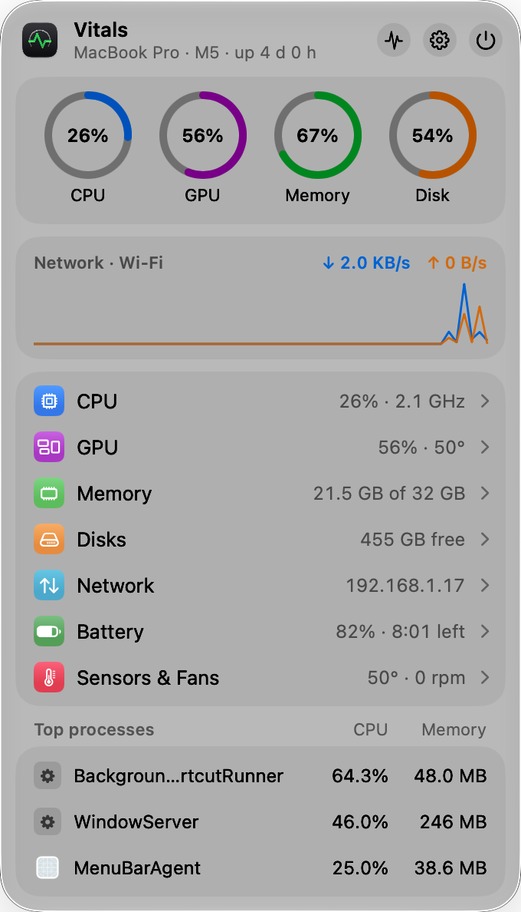
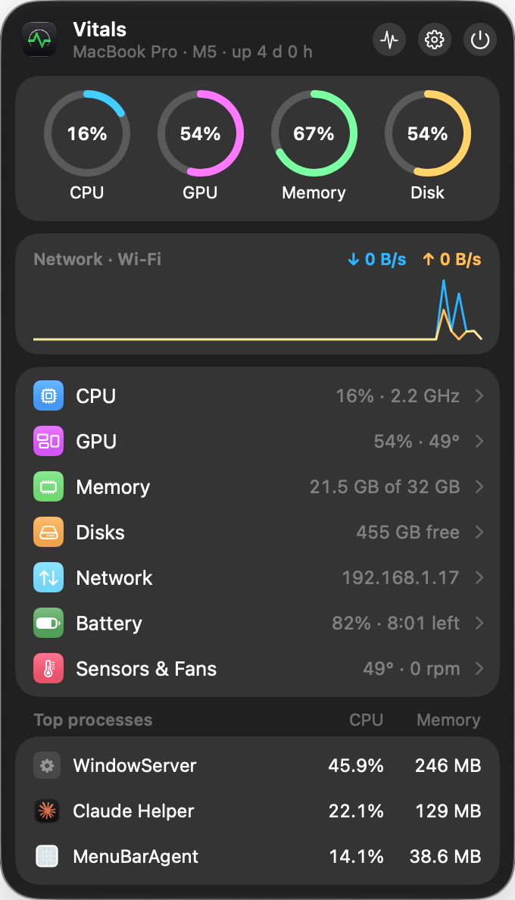
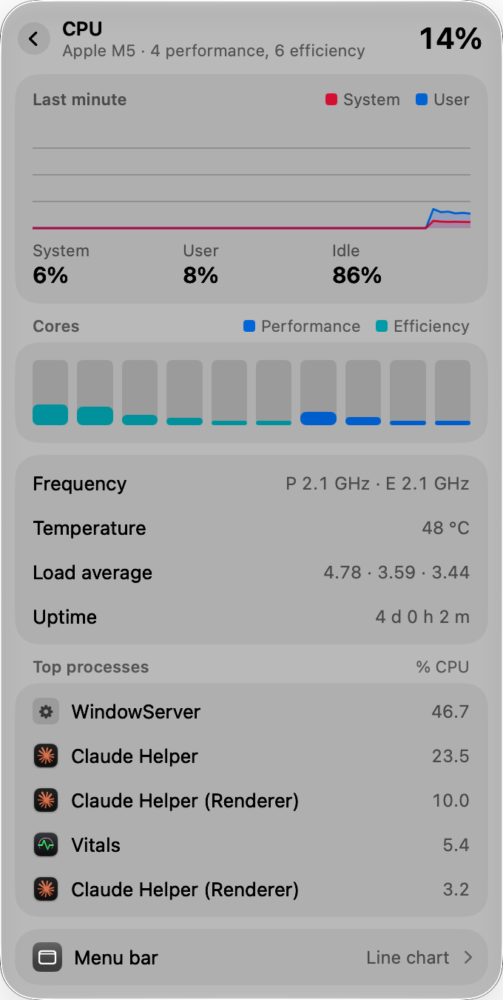
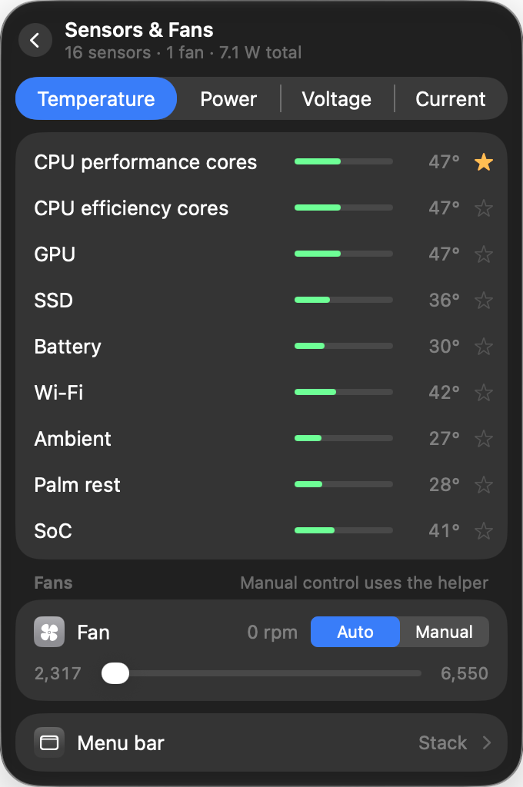

# Vitals

A native macOS menu-bar system monitor: CPU, GPU, memory, disks, network, battery, sensors, fans, Bluetooth batteries and a world clock. It's free, with no account, tracking or subscription, and the whole app lives in one menu-bar panel.

<p>
  
  
</p>

## Features

- **CPU:** total, system, user and idle; per-core bars for performance and efficiency cores; average frequency per cluster; temperature; load average; uptime; top processes (right-click to quit one).
- **GPU:** device, renderer and tiler utilization, memory in use, frequency, temperature and power.
- **Memory:** pressure history, app / wired / compressed / free, swap, cached files, page ins and outs, top processes.
- **Disks:** every volume with used and free space, read and write activity, SMART status, and Eject for external drives.
- **Network:** download and upload speed, today's totals, interface, Wi‑Fi signal and link speed, local and public IP (copyable), router and internet latency, DNS, and per-process traffic.
- **Battery:** level, health, cycles, capacity, temperature, voltage and current, power draw, adapter watts, Low Power Mode, and apps using significant energy.
- **Sensors & Fans:** temperature, power, voltage and current sensors. Star any temperature to show it in the menu bar. Manual fan speed through an optional helper.
- **Bluetooth:** battery levels of keyboards, mice, trackpads and AirPods.
- **Clock:** several time zones and a custom menu-bar format.
- **Menu bar:**
  - 13 widget styles: Mini, Line chart, Bar chart, Pie chart, Network chart, Speed, Label, Tachometer, Memory, Battery, Stack, Dot and Text (with `$cpu`, `$temp`, `$down` and other tokens).
  - One combined item or one item per module. Any module can also get its own item.
  - Drag to reorder. Colors by value, accent color or monochrome.
- **Alerts:** a notification when CPU, GPU, memory, disk, temperature, battery or network speed crosses a limit for a set time.
- **Automation:** the `vitals` command-line tool, `vitals://` URLs, two Shortcuts actions and a global shortcut (⌃⌥V) that opens the panel.

<p>
  
  
</p>

## Design

- **One panel, no windows:** module pages, Settings, the menu-bar editor and Alerts all open as pages inside the menu-bar panel.
- **Stock controls:** SwiftUI switches, menus, segmented controls and capsule buttons, with Liquid Glass on macOS 26 and later. Vitals follows light and dark mode and the system accent color.
- **Measured spacing:** a 10pt panel edge, 8pt between sections, 16pt section corners (concentric with the 26pt panel), 30pt rows and a 12pt row inset. The values are in [`DesignSystem.swift`](Vitals/DesignSystem.swift).

## Command line

Install it from **Settings › Shortcuts & Command Line**, then run:

```bash
vitals get cpu
vitals get all --json
vitals open sensors
vitals fan 0 3000
vitals fan 0 auto
open "vitals://open?page=network"
```

## Requirements

- macOS 14 Sonoma or later. Liquid Glass appears on macOS 26 and later.
- Apple silicon or Intel. Frequencies, GPU power and the HID thermal sensors are Apple-silicon readings.
- Xcode 16 or later.

## Build and run

1. Open `Vitals.xcodeproj`.
2. Run. Builds are signed ad hoc, so you don't need to choose a team.

No permissions are needed to monitor. On first launch a welcome panel lets you pick a combined or separate menu bar, and optionally allow notifications (for alerts) and install the fan helper (asks for your password once).

### Design previews

Debug builds can show any page in a borderless panel for screenshots:

```bash
Vitals.app/Contents/MacOS/Vitals -preview main dark   # main, cpu, gpu, memory, disk, network, battery, sensors, clock, settings, widgets, alerts, onboarding
```

`vitals render <folder>` writes every module × widget style to PNGs in light and dark.

## How it works

See [docs/SPEC.md](docs/SPEC.md) for each reading and the macOS API behind it.
